# Capítulo 1 — Introdução às equações diferenciais: exercícios

São 65 exercícios. Os pontos antes de cada número indicam a dificuldade: **•** fácil, **••** médio, **•••** difícil e **••••** desafio. Tente resolver antes de abrir a resposta. Os marcados com ★ têm [solução completa com animação](#soluções-completas).

Muitos enunciados são adaptados de *Calculus Volume 1* (OpenStax, CC BY-NC-SA 4.0).

## Lista

`•` **1.1** Dê a ordem de cada equação e diga se ela é linear: (a) $y''+3y'-y=\operatorname{sen} x$; (b) $(y')^2+y=x$; (c) $y'''=y\,y'$.

Resposta

(a) ordem 2, linear; (b) ordem 1, não linear; (c) ordem 3, não linear.

`•` **1.2** Verifique que $y=C_1e^{2x}+C_2e^{-x}$ é solução de $y''-y'-2y=0$ para quaisquer constantes $C_1$, $C_2$.

Resposta

$4C_1e^{2x}+C_2e^{-x}-(2C_1e^{2x}-C_2e^{-x})-2(C_1e^{2x}+C_2e^{-x})=0$.

`•` **1.3** Para quais valores de $r$ a função $y=e^{rx}$ é solução de $y''+y'-6y=0$?

Resposta

$r^2+r-6=0$: $r=2$ ou $r=-3$.

`•` **1.4** Resolva o PVI $y'=x\,e^{x^2}$, $y(0)=1$.

Resposta

$y=\tfrac12e^{x^2}+\tfrac12$.

`•` **1.5** Resolva o PVI $y''=6x$, $y(0)=1$, $y'(0)=2$.

Resposta

$y=x^3+2x+1$.

`•` **1.6** Uma pedra é lançada para cima, do chão, a $20$ m/s ($g=9{,}8$ m/s$^2$). Escreva $v(t)$ e $s(t)$ e encontre a altura máxima.

Resposta

$v=20-9{,}8t$, $s=20t-4{,}9t^2$; máximo em $t\approx2{,}04$ s, $s\approx20{,}4$ m.

`•` **1.7** Encontre e classifique os equilíbrios de $y'=y^2-4$.

Resposta

$y=-2$ estável; $y=2$ instável.

`•` **1.8** Encontre e classifique os equilíbrios de $y'=y(y-3)^2$.

Resposta

$y=0$ instável; $y=3$ semiestável.

`•` **1.9** Faça dois passos do método de Euler com $h=0{,}5$ para $y'=2x-y$, $y(0)=1$, e compare com a solução exata $y=2x-2+3e^{-x}$ em $x=1$.

Resposta

$y_1=0{,}5$, $y_2=0{,}75$; exato $3/e\approx1{,}104$.

`•` **1.10** Resolva $y'=\dfrac yx$ ($x>0$) por separação de variáveis.

Resposta

$y=Cx$.

`•` **1.11** Resolva $y'=e^{x-y}$.

Resposta

$e^y=e^x+C$, ou $y=\ln(e^x+C)$.

`•` **1.12** Resolva $y'=1+y^2$, $y(0)=0$. Em que intervalo a solução existe?

Resposta

$y=\operatorname{tg} x$, para $-\tfrac\pi2<x<\tfrac\pi2$.

`•` **1.13** Resolva $y'=x\,y^2$, $y(0)=1$, e diga onde a solução deixa de existir.

Resposta

$y=\dfrac2{2-x^2}$; explode em $x=\pm\sqrt2$.

`•` **1.14** Um corpo a $80$\textdegree C é deixado num ambiente a $20$\textdegree C, com $T'=-0{,}1(T-20)$ ($t$ em min). Encontre $T(t)$ e quando ele chega a $40$\textdegree C.

Resposta

$T=20+60e^{-0{,}1t}$; $t=10\ln3\approx11{,}0$ min.

`•` **1.15** Para $P'=0{,}5P\big(1-\tfrac P{200}\big)$, dê os equilíbrios, a capacidade de suporte e o valor de $P$ em que o crescimento é mais rápido (com a taxa nesse ponto).

Resposta

$P=0$ e $P=200=K$; $P=100$, com $P'=25$.

`•` **1.16** Com os dados do exercício anterior e $P(0)=20$, calcule $P(4)$.

Resposta

$P(4)=\dfrac{4000e^2}{180+20e^2}\approx90{,}2$.

`•` **1.17** Resolva $y'+2y=4$ e descreva o comportamento das soluções quando $x\to\infty$.

Resposta

$y=2+Ce^{-2x}\to2$.

`•` **1.18** Resolva $y'+\dfrac yx=3x$ ($x>0$) pelo fator integrante.

Resposta

$\mu=x$; $y=x^2+\dfrac Cx$.

`•` **1.19** Resolva o PVI $y'-3y=e^{2x}$, $y(0)=0$.

Resposta

$y=e^{3x}-e^{2x}$.

`•` **1.20** Um tanque tem $100$ L de água pura. Entra salmoura com $0{,}2$ kg/L a $5$ L/min e sai mistura a $5$ L/min. Encontre o sal $u(t)$ e quanto há após $20$ min.

Resposta

$u=20(1-e^{-t/20})$; $u(20)=20(1-e^{-1})\approx12{,}6$ kg.

`••` **1.21** **Um campo que espalha as soluções.** Para $y'=y-x$, esboce o campo de direções, encontre a solução geral e mostre que só uma solução não se afasta da reta $y=x+1$. Compare $y(0)=1$ e $y(0)=1{,}1$ em $x=5$. ★ [ver solução](#ex-1-21)

Resposta

$y=x+1+Ce^x$; só $C=0$; $y(5)=6$ contra $y(5)\approx20{,}8$.

`••` **1.22** **Euler e o número $e$.** Aplique o método de Euler a $y'=y$, $y(0)=1$, em $[0,1]$ com $n$ passos de tamanho $h=\frac1n$. Mostre que a aproximação de $y(1)$ é $\big(1+\frac1n\big)^n$ e calcule-a para $n=1,2,4,10,100$. ★ [ver solução](#ex-1-22)

Resposta

$2;\ 2{,}25;\ 2{,}441;\ 2{,}594;\ 2{,}705$, tendendo a $e\approx2{,}718$.

`••` **1.23** **Soluções que acabam.** Resolva $y'=-\dfrac xy$, $y(0)=2$. Em que intervalo a solução existe? O que acontece nas pontas? ★ [ver solução](#ex-1-23)

Resposta

$y=\sqrt{4-x^2}$, para $-2<x<2$; a inclinação tende a $\mp\infty$ nas pontas.

`••` **1.24** **A hora da morte.** Um corpo é encontrado a $30$\textdegree C numa sala a $20$\textdegree C; uma hora depois está a $28$\textdegree C. Supondo a lei de Newton e temperatura de $37$\textdegree C no momento da morte, há quanto tempo ocorreu a morte quando o corpo foi encontrado? ★ [ver solução](#ex-1-24)

Resposta

Cerca de $2{,}38$ h, isto é, $2$ h $23$ min.

`••` **1.25** **Resolvendo a logística.** Resolva $P'=rP\big(1-\frac PK\big)$, $P(0)=P_0$, por separação de variáveis e frações parciais. Para $r=0{,}2311$, $K=4000$ e $P_0=900$, quando a população cresce mais rápido? ★ [ver solução](#ex-1-25)

Resposta

$P=\dfrac{KP_0e^{rt}}{K-P_0+P_0e^{rt}}$; em $t=\frac1r\ln\frac{K-P_0}{P_0}\approx5{,}35$ anos, com $P=2000$.

`••` **1.26** **Velocidade terminal.** Um paraquedista cai com $v'=9{,}8-0{,}2v$, $v(0)=0$ (SI). Encontre $v(t)$, a distância percorrida $s(t)$ e quanto tempo leva para atingir $95%$ da velocidade terminal. ★ [ver solução](#ex-1-26)

Resposta

$v=49(1-e^{-0{,}2t})$; $s=49t-245(1-e^{-0{,}2t})$; $t=5\ln20\approx15$ s.

`••` **1.27** Classifique os equilíbrios de $y'=(y-1)(y-4)$ e esboce algumas soluções.

Resposta

$y=1$ estável; $y=4$ instável.

`••` **1.28** Use Euler com $h=0{,}25$ (quatro passos) para estimar $y(1)$ em $y'=x^2-y$, $y(0)=1$. A solução exata é $y=x^2-2x+2-e^{-x}$.

Resposta

$0{,}75;\ 0{,}578;\ 0{,}496;\ 0{,}513$; exato $1-e^{-1}\approx0{,}632$.

`••` **1.29** Resolva $y'=3x^2(y+1)$, $y(0)=0$.

Resposta

$y=e^{x^3}-1$.

`••` **1.30** Resolva $y'=\dfrac{\cos x}{y}$, $y(0)=2$.

Resposta

$y=\sqrt{2\operatorname{sen} x+4}$.

`••` **1.31** Resolva $\dfrac{dy}{dx}=\dfrac{1+y^2}{1+x^2}$, $y(0)=1$, e simplifique a resposta.

Resposta

$\operatorname{arctg} y=\operatorname{arctg} x+\tfrac\pi4$, ou $y=\dfrac{1+x}{1-x}$.

`••` **1.32** Resolva $y'=y\ln y$, $y(0)=e$.

Resposta

$y=e^{e^x}$.

`••` **1.33** Resolva $y'+2xy=x$, $y(0)=0$.

Resposta

$y=\tfrac12\big(1-e^{-x^2}\big)$.

`••` **1.34** Resolva $y'+y\operatorname{tg} x=\sec x$, $y(0)=1$, em $|x|<\tfrac\pi2$.

Resposta

$\mu=\sec x$; $y=\operatorname{sen} x+\cos x$.

`••` **1.35** Resolva $xy'-2y=x^3e^x$ ($x>0$).

Resposta

$y=x^2(e^x+C)$.

`••` **1.36** Escreva $P'=0{,}02P-0{,}00004P^2$ na forma logística e identifique $r$ e $K$.

Resposta

$P'=0{,}02P(1-P/500)$: $r=0{,}02$, $K=500$.

`••` **1.37** Uma população logística tem $K=1000$, $P(0)=100$ e atinge $500$ em $t=10$. Encontre $r$.

Resposta

$r=\tfrac{\ln9}{10}\approx0{,}220$.

`••` **1.38** Estime $y(1)$ para $y'=y$, $y(0)=1$, com Euler de passo $h=0{,}5$ e $h=0{,}25$. Compare os erros.

Resposta

$2{,}25$ e $2{,}441$; erros $0{,}47$ e $0{,}28$ (cerca da metade).

`••` **1.39** Um bolo sai do forno a $180$\textdegree C para uma sala a $25$\textdegree C e está a $100$\textdegree C após $10$ min. Quando estará a $50$\textdegree C?

Resposta

$t\approx25{,}1$ min.

`••` **1.40** Verifique que $y=\dfrac1{1+Ce^{-x}}$ resolve $y'=y(1-y)$ e encontre a solução com $y(0)=\tfrac14$.

Resposta

$C=3$: $y=\dfrac1{1+3e^{-x}}$.

`•••` **1.41** **Logística com colheita.** Uma população de peixes segue $P'=0{,}4P\big(1-\frac P{1000}\big)-60$ (pesca constante de 60 por ano). Encontre e classifique os equilíbrios. O que acontece se $P(0)=150$? Qual a maior pesca sustentável? ★ [ver solução](#ex-1-41)

Resposta

$P\approx183{,}8$ (instável) e $P\approx816{,}2$ (estável); com $P(0)=150$ a população se extingue; pesca máxima $100$ por ano.

`•••` **1.42** **Mistura com volume variável.** Um tanque tem $100$ L de água pura. Entra salmoura com $0{,}5$ kg/L a $3$ L/min e sai a mistura a $2$ L/min. Encontre o sal $u(t)$ e a concentração quando o volume dobrar. ★ [ver solução](#ex-1-42)

Resposta

$u=\tfrac12(100+t)-\dfrac{500\,000}{(100+t)^2}$; em $t=100$: $87{,}5$ kg, concentração $0{,}4375$ kg/L.

`•••` **1.43** **Uma equação de Bernoulli.** Resolva $y'+y=y^2$ com a substituição $v=\frac1y$. Descreva as soluções com $y(0)=\tfrac13$, $y(0)=1$ e $y(0)=2$. ★ [ver solução](#ex-1-43)

Resposta

$y=\dfrac1{1+Ce^x}$; tende a $0$, fica em $1$, e explode em $x=\ln2$, respectivamente.

`•••` **1.44** **Trajetórias ortogonais.** Encontre as curvas que cortam todas as parábolas $y=Cx^2$ em ângulo reto. ★ [ver solução](#ex-1-44)

Resposta

As elipses $x^2+2y^2=K$.

`•••` **1.45** **Esvaziando um tanque.** Pela lei de Torricelli, o nível de um tanque cilíndrico que esvazia por um furo no fundo satisfaz $h'=-0{,}1\sqrt h$ ($h$ em m, $t$ em min). Com $h(0)=4$, encontre $h(t)$, o tempo para esvaziar e o tempo para o nível cair à metade. ★ [ver solução](#ex-1-45)

Resposta

$h=(2-0{,}05t)^2$; esvazia em $40$ min; metade do nível em $\approx11{,}7$ min.

`•••` **1.46** Mostre que o PVI $y'=3y^{2/3}$, $y(0)=0$ tem pelo menos duas soluções. Por que isso não contradiz a intuição do campo de direções?

Resposta

$y\equiv0$ e $y=x^3$; $f(y)=3y^{2/3}$ não tem derivada limitada perto de $y=0$.

`•••` **1.47** Resolva $y'=y^2-1$, $y(0)=0$, usando frações parciais.

Resposta

$y=\dfrac{1-e^{2x}}{1+e^{2x}}=-\operatorname{tgh} x$.

`•••` **1.48** Resolva $y'=\dfrac{x^2}{1-y^2}$ (solução implícita).

Resposta

$3y-y^3=x^3+C$.

`•••` **1.49** Resolva $y'+y=\operatorname{sen} x$.

Resposta

$y=\tfrac12(\operatorname{sen} x-\cos x)+Ce^{-x}$.

`•••` **1.50** Resolva $y'-\dfrac yx=x\operatorname{sen} x$ ($x>0$).

Resposta

$y=x(C-\cos x)$.

`•••` **1.51** Resolva $(x+y^2)\,dy=y\,dx$ tratando $x$ como função de $y$.

Resposta

$\dfrac{dx}{dy}-\dfrac xy=y$: $x=y^2+Cy$.

`•••` **1.52** Aplique Euler a $y'=-2y$, $y(0)=1$, com $h=1{,}5$. O que acontece? Para quais $h$ as aproximações decaem como a solução exata?

Resposta

$y_{n+1}=(1-2h)y_n=(-2)^n$ oscila e diverge; é preciso $|1-2h|<1$, isto é, $0<h<1$.

`•••` **1.53** Mostre, derivando a equação logística, que $P''=rP'\big(1-\tfrac{2P}K\big)$ e conclua que a inflexão ocorre em $P=\tfrac K2$.

Resposta

Derive $rP-\tfrac rKP^2$ pela regra da cadeia.

`•••` **1.54** O modelo de Gompertz é $P'=rP\ln\frac KP$. Resolva-o com a substituição $u=\ln P$.

Resposta

$u'=r(\ln K-u)$: $P=K\exp\big(Ce^{-rt}\big)$.

`•••` **1.55** Um medicamento é infundido a $2$ mg/h e eliminado a uma taxa de $10%$ da quantidade por hora. Com $A(0)=0$, encontre $A(t)$ e quando se atinge $90%$ do nível de equilíbrio.

Resposta

$A=20(1-e^{-0{,}1t})$; $t=10\ln10\approx23$ h.

`•••` **1.56** Um investimento rende $5%$ ao ano (capitalização contínua) e recebe depósitos contínuos de R\$ $1200$ por ano. Com $S(0)=0$, quanto há após $20$ anos?

Resposta

$S=24\,000(e^{0{,}05t}-1)$; $S(20)\approx$ R\$ $41\,239$.

`•••` **1.57** Com resistência quadrática, $v'=9{,}8-0{,}098v^2$, $v(0)=0$. Encontre $v(t)$ e a velocidade terminal.

Resposta

$v=10\operatorname{tgh}(0{,}98t)$; terminal $10$ m/s.

`•••` **1.58** Resolva $y'=(x+y)^2$ com a substituição $u=x+y$.

Resposta

$u'=1+u^2$: $y=\operatorname{tg}(x+C)-x$.

`•••` **1.59** Resolva a equação homogênea $y'=\dfrac{x^2+y^2}{xy}$ ($x>0$) com $v=\frac yx$.

Resposta

$xv'=\tfrac1v$: $y^2=2x^2\ln x+Cx^2$.

`•••` **1.60** Uma doença se espalha numa cidade de $5000$ pessoas segundo $y'=0{,}0002\,y(5000-y)$, com $y(0)=10$. Quando metade estará infectada?

Resposta

Logística com $r=1$, $K=5000$: $t=\ln499\approx6{,}2$ dias.

`••••` **1.61** Mostre que toda solução de $y'+p(x)y=q(x)$ (com $p$, $q$ contínuas) é $y=e^{-\int p}\Big(\int e^{\int p}\,q\,dx+C\Big)$ e que o PVI com $y(x_0)=y_0$ tem exatamente uma solução.

Resposta

Se $y$ é solução, $(\mu y)'=\mu q$ com $\mu=e^{\int p}>0$; integre e use $y(x_0)$ para fixar $C$.

`••••` **1.62** Encontre as trajetórias ortogonais da família de circunferências $x^2+y^2=2cx$.

Resposta

$y'=\tfrac{y^2-x^2}{2xy}$ para a família; as ortogonais são $x^2+y^2=2ky$.

`••••` **1.63** (Clepsidra) Pela lei de Torricelli, $A(h)\,h'=-k\sqrt h$. Que forma deve ter um recipiente de revolução para que o nível desça a taxa constante?

Resposta

$A=\pi x^2$ proporcional a $\sqrt h$: $x\propto h^{1/4}$, ou $h=cx^4$.

`••••` **1.64** Um cabo suspenso satisfaz $y''=\tfrac1a\sqrt{1+(y')^2}$. Com $p=y'$, resolva e mostre que $y=a\cosh\frac xa$ (com $y'(0)=0$, $y(0)=a$).

Resposta

$\int\tfrac{dp}{\sqrt{1+p^2}}=\tfrac xa$: $p=\operatorname{senh}\tfrac xa$, logo $y=a\cosh\tfrac xa$.

`••••` **1.65** (Riccati) Verifique que $y_1=\tfrac1x$ resolve $y'=y^2-\tfrac2{x^2}$ e encontre a solução geral com $y=y_1+\tfrac1v$.

Resposta

$v'+\tfrac2xv=-1$: $y=\dfrac1x+\dfrac{3x^2}{C-x^3}$.

## Soluções completas

### 1.21 — Um campo que espalha as soluções

*Origem: OpenStax, inspirado na Figura 1.1.*

> Para $y'=y-x$, esboce o campo de direções, encontre a solução geral e mostre que só uma solução não se afasta da reta $y=x+1$. Compare $y(0)=1$ e $y(0)=1{,}1$ em $x=5$.

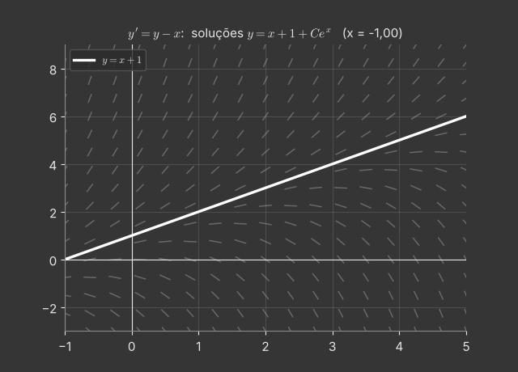

**Linear.** Na forma padrão, $y'-y=-x$, com $\mu=e^{-x}$:
$$(e^{-x}y)'=-xe^{-x}\ \Rightarrow\ e^{-x}y=(x+1)e^{-x}+C\ \Rightarrow\ y=x+1+Ce^{x}.$$

**A reta especial.** Com $C=0$, $y=x+1$: de fato $y'=1=(x+1)-x$. ✓ No campo, os segmentos sobre essa reta têm inclinação exatamente $1$, a da própria reta.

**Instabilidade.** Para $C\neq0$, o termo $Ce^x$ cresce sem limite: acima da reta ($C>0$) as soluções sobem cada vez mais rápido; abaixo ($C<0$), despencam. Uma diferença minúscula na condição inicial vira uma diferença enorme:
- $y(0)=1$: $C=0$, $y(5)=6$;
- $y(0)=1{,}1$: $C=0{,}1$, $y(5)=6+0{,}1e^5\approx20{,}8$.

**Contraste** com $y'=x-y$ (Figura 1.1): lá o fator é $e^{-x}$ e todas as soluções convergem para a reta. O sinal do coeficiente de $y$ decide se o campo junta ou espalha as soluções.

**Animação.** As soluções partem de valores iniciais próximos e seguem o campo, afastando-se da reta $y=x+1$.

---

### 1.22 — Euler e o número $e$

*Origem: OpenStax, inspirado no Exemplo 1.4.*

> Aplique o método de Euler a $y'=y$, $y(0)=1$, em $[0,1]$ com $n$ passos de tamanho $h=\frac1n$. Mostre que a aproximação de $y(1)$ é $\big(1+\frac1n\big)^n$ e calcule-a para $n=1,2,4,10,100$.

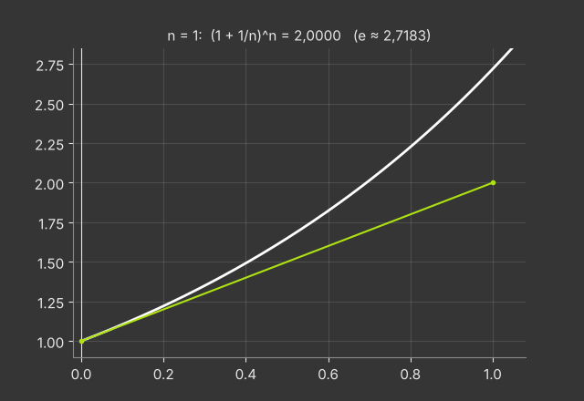

**Um passo:** $y_{k+1}=y_k+h\,y_k=(1+h)\,y_k$. Começando em $y_0=1$, depois de $n$ passos:
$$y_n=(1+h)^n=\Big(1+\frac1n\Big)^n .$$

**Valores:**

| $n$ | $(1+1/n)^n$ | erro |
|---|---|---|
| 1 | 2 | 0,718 |
| 2 | 2,25 | 0,468 |
| 4 | 2,4414 | 0,277 |
| 10 | 2,5937 | 0,125 |
| 100 | 2,7048 | 0,0135 |

A solução exata é $y=e^x$, então $y(1)=e$. O limite $\lim(1+\frac1n)^n=e$ (visto no capítulo 3 do Cálculo I) aparece aqui como a convergência do método de Euler.

**Ordem do erro.** De $n=10$ para $n=100$ o erro cai cerca de 10 vezes: erro proporcional a $h$, como esperado para o método de Euler. Para ganhar uma casa decimal é preciso dez vezes mais passos, por isso existem métodos melhores (Runge–Kutta).

**Animação.** As poligonais de Euler com $1,2,4,\dots,64$ passos se aproximam de $y=e^x$; o valor final se aproxima de $e$.

---

### 1.23 — Soluções que acabam

*Origem: OpenStax, inspirado no Exemplo 1.5.*

> Resolva $y'=-\dfrac xy$, $y(0)=2$. Em que intervalo a solução existe? O que acontece nas pontas?

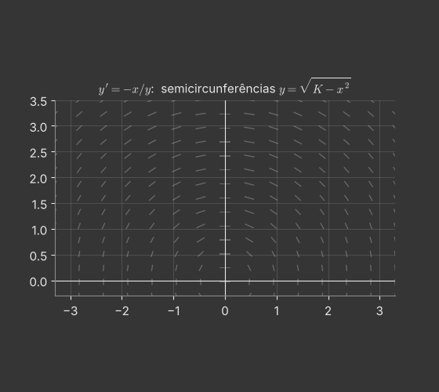

**Separando:** $y\,dy=-x\,dx\Rightarrow\frac{y^2}2=-\frac{x^2}2+C\Rightarrow x^2+y^2=K$.

As soluções são **arcos de circunferência** centrados na origem. Com $y(0)=2$, $K=4$ e, como $y>0$ no ponto inicial, ficamos com a metade de cima:
$$y=\sqrt{4-x^2}.$$

**Intervalo.** A equação exige $y\neq0$. A solução existe em $-2<x<2$; quando $x\to\pm2$, $y\to0$ e $y'=-x/y\to\mp\infty$: a tangente fica vertical e a solução não pode continuar como função de $x$.

**Lição.** Uma equação com coeficientes bem comportados ($-x/y$ é simples) pode ter soluções que existem só num intervalo limitado, mesmo sem nenhuma "explosão": a curva simplesmente dá a volta.

**Campo de direções.** Os segmentos são perpendiculares ao raio (inclinação $-x/y$ contra $y/x$ do raio): o campo "gira" em torno da origem.

**Animação.** As semicircunferências de raios $1$ a $3$ são traçadas seguindo o campo de direções.

---

### 1.24 — A hora da morte

*Origem: OpenStax, inspirado na seção 1.3.*

> Um corpo é encontrado a $30$\textdegree C numa sala a $20$\textdegree C; uma hora depois está a $28$\textdegree C. Supondo a lei de Newton e temperatura de $37$\textdegree C no momento da morte, há quanto tempo ocorreu a morte quando o corpo foi encontrado?

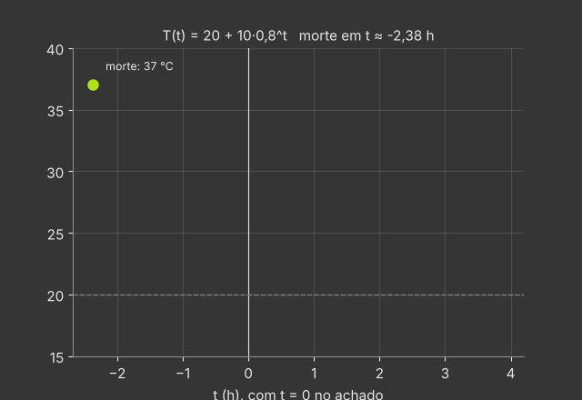

**Modelo:** $T'=k(T-20)\Rightarrow T(t)=20+(T_0-20)e^{kt}$.

**$k$ pelas duas medições.** Contando o tempo a partir do achado: $T=30$ e, uma hora depois, $28$. Então
$$\frac{28-20}{30-20}=e^{k}\Rightarrow k=\ln0{,}8\approx-0{,}2231\ \text{h}^{-1}.$$

**Voltando no tempo.** Seja $t_m<0$ o instante da morte, com $T(t_m)=37$:
$$37-20=(30-20)e^{kt_m}\Rightarrow t_m=\frac{\ln1{,}7}{k}=\frac{0{,}5306}{-0{,}2231}\approx-2{,}38\ \text{h}.$$

A morte ocorreu cerca de **2 h 23 min antes** de o corpo ser encontrado.

**Conferência:** de $37$ a $30$, a diferença para o ambiente vai de $17$ a $10$; com fator $0{,}8$ por hora, $17\cdot0{,}8^{2{,}38}\approx10$. ✓

**Limitações.** O modelo supõe sala a temperatura constante e corpo homogêneo; na prática a perícia usa curvas corrigidas, mas a ideia é a mesma.

**Animação.** A curva $T(t)$ é traçada desde a morte; os dois pontos medidos ficam marcados e o tempo decorrido é indicado.

---

### 1.25 — Resolvendo a logística

*Origem: OpenStax, inspirado no Exemplo 1.6.*

> Resolva $P'=rP\big(1-\frac PK\big)$, $P(0)=P_0$, por separação de variáveis e frações parciais. Para $r=0{,}2311$, $K=4000$ e $P_0=900$, quando a população cresce mais rápido?

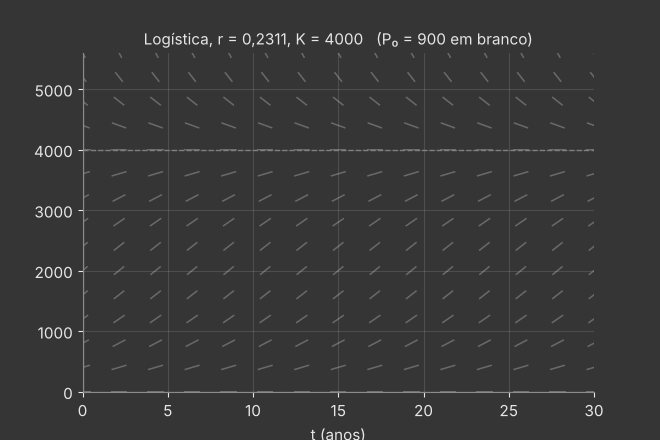

**Separando:** $\displaystyle\int\frac{K\,dP}{P(K-P)}=\int r\,dt$.

**Frações parciais:** $\dfrac{K}{P(K-P)}=\dfrac1P+\dfrac1{K-P}$. Integrando:
$$\ln P-\ln(K-P)=rt+C\ \Rightarrow\ \frac{P}{K-P}=Ae^{rt},\qquad A=\frac{P_0}{K-P_0}.$$

**Isolando $P$:** $P=(K-P)Ae^{rt}\Rightarrow P(1+Ae^{rt})=KAe^{rt}$, e multiplicando por $K-P_0$:
$$P(t)=\frac{KP_0e^{rt}}{K-P_0+P_0e^{rt}} .$$

**Crescimento máximo.** $P'=rP-\frac rKP^2$ é uma parábola em $P$, máxima em $P=\frac K2$. Isso acontece quando $Ae^{rt}=1$:
$$t^*=\frac1r\ln\frac{K-P_0}{P_0}=\frac{\ln(3100/900)}{0{,}2311}\approx5{,}35\ \text{anos},$$
com $P=2000$ e taxa $P'=\frac{rK}4\approx231$ cervos por ano.

**Simetria.** A curva logística é simétrica em relação ao ponto de inflexão: o tempo para ir de $P_0$ a $K/2$ é o mesmo que de $K/2$ até $K-P_0$.

**Animação.** Várias curvas logísticas (com $P_0$ diferentes) são traçadas sobre o campo de direções; o ponto de inflexão aparece em $P=2000$.

---

### 1.26 — Velocidade terminal

*Origem: OpenStax, inspirado no Exemplo 1.8.*

> Um paraquedista cai com $v'=9{,}8-0{,}2v$, $v(0)=0$ (SI). Encontre $v(t)$, a distância percorrida $s(t)$ e quanto tempo leva para atingir $95%$ da velocidade terminal.

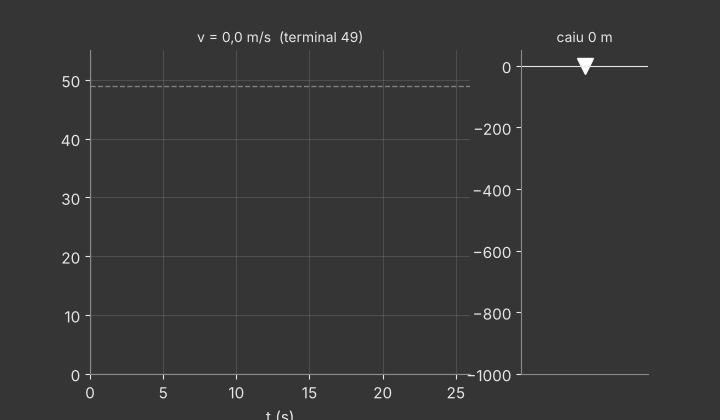

**Velocidade (linear):** $v'+0{,}2v=9{,}8$, $\mu=e^{0{,}2t}$:
$$(e^{0{,}2t}v)'=9{,}8e^{0{,}2t}\Rightarrow v=49+Ce^{-0{,}2t},\quad v(0)=0\Rightarrow v(t)=49\big(1-e^{-0{,}2t}\big).$$

**Velocidade terminal:** $49$ m/s ($\approx176$ km/h), o equilíbrio $v'=0\iff v=9{,}8/0{,}2$.

**Distância:** $s(t)=\int_0^tv=49t-245\big(1-e^{-0{,}2t}\big)$.

**95% da terminal:** $1-e^{-0{,}2t}=0{,}95\Rightarrow t=5\ln20\approx15{,}0$ s, quando já se caiu $s\approx49\cdot15-245\cdot0{,}95\approx502$ m.

**Sem resistência** ($v=9{,}8t$) a velocidade de 49 m/s seria atingida em 5 s; a resistência faz a aproximação ser assintótica.

**Animação.** A velocidade cresce e se aproxima da reta $v=49$; ao lado, a posição do paraquedista desce.

---

### 1.41 — Logística com colheita

*Origem: OpenStax, inspirado na seção 1.4.*

> Uma população de peixes segue $P'=0{,}4P\big(1-\frac P{1000}\big)-60$ (pesca constante de 60 por ano). Encontre e classifique os equilíbrios. O que acontece se $P(0)=150$? Qual a maior pesca sustentável?

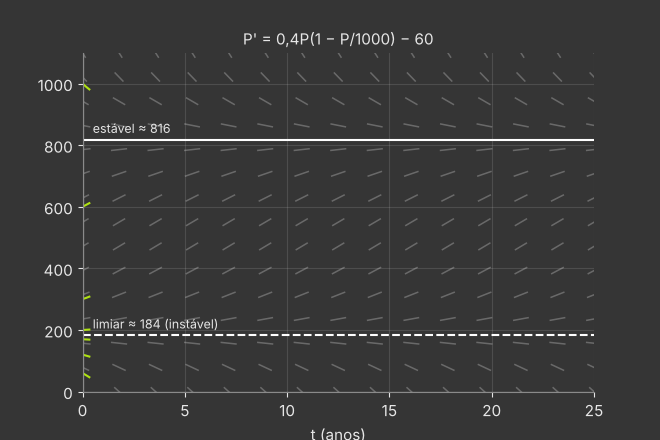

**Equilíbrios:** $0{,}4P-0{,}0004P^2-60=0\iff P^2-1000P+150\,000=0$:
$$P=\frac{1000\pm\sqrt{400\,000}}2\approx183{,}8\ \text{ou}\ 816{,}2 .$$

**Sinal de $P'$** (parábola voltada para baixo em $P$): negativo abaixo de $183{,}8$, positivo entre as raízes, negativo acima de $816{,}2$. Logo:
- $816{,}2$ é **estável** (as soluções vizinhas convergem para ele);
- $183{,}8$ é **instável**: um limiar.

**$P(0)=150$:** abaixo do limiar, $P'<0$ e continua negativo: a população cai até zero em tempo finito. A pesca, que era tolerável para uma população grande, extingue uma pequena.

**Pesca máxima sustentável.** Com pesca $H$, os equilíbrios existem se $0{,}4P(1-P/1000)=H$ tem solução, e o máximo do lado esquerdo é $\frac{rK}4=\frac{0{,}4\cdot1000}4=100$. Para $H>100$ não há equilíbrio e a população sempre se extingue.

**Animação.** As soluções partem de vários $P(0)$; as que começam acima de $183{,}8$ sobem ou descem até $816$, e as de baixo despencam.

---

### 1.42 — Mistura com volume variável

*Origem: OpenStax, inspirado na seção 1.3.*

> Um tanque tem $100$ L de água pura. Entra salmoura com $0{,}5$ kg/L a $3$ L/min e sai a mistura a $2$ L/min. Encontre o sal $u(t)$ e a concentração quando o volume dobrar.

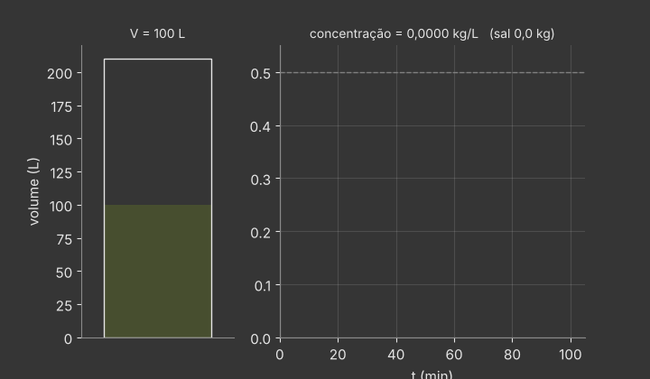

**Volume:** $V(t)=100+t$ (entra 3, sai 2).

**Balanço de sal:** entra $0{,}5\cdot3=1{,}5$ kg/min; sai $2\cdot\frac{u}{V}$:
$$u'+\frac{2}{100+t}\,u=1{,}5 .$$
Agora a equação é linear com coeficiente **variável**, não separável.

**Fator integrante:** $\mu=e^{\int\frac2{100+t}dt}=(100+t)^2$:
$$\big((100+t)^2u\big)'=1{,}5(100+t)^2\Rightarrow(100+t)^2u=\tfrac12(100+t)^3+C .$$
Com $u(0)=0$: $C=-\tfrac12\cdot10^6$, logo
$$u(t)=\frac{100+t}2-\frac{500\,000}{(100+t)^2}.$$

**Quando $V=200$** ($t=100$): $u=100-12{,}5=87{,}5$ kg, concentração $\frac{87{,}5}{200}=0{,}4375$ kg/L.

**Longo prazo:** a concentração $u/V=\frac12-\frac{500\,000}{(100+t)^3}\to0{,}5$ kg/L, a da salmoura que entra (se o tanque não transbordar antes).

**Animação.** O nível do tanque sobe e a cor da mistura se intensifica; ao lado, a concentração se aproxima de $0{,}5$.

---

### 1.43 — Uma equação de Bernoulli

*Origem: OpenStax, inspirado na seção 1.5.*

> Resolva $y'+y=y^2$ com a substituição $v=\frac1y$. Descreva as soluções com $y(0)=\tfrac13$, $y(0)=1$ e $y(0)=2$.

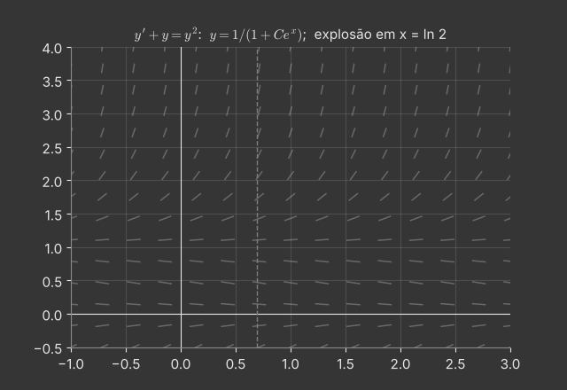

**Substituição.** Com $v=\frac1y$, $v'=-\frac{y'}{y^2}$. Dividindo a equação por $-y^2$:
$$-\frac{y'}{y^2}-\frac1y=-1\ \Rightarrow\ v'-v=-1,$$
que é **linear**.

**Resolvendo:** $\mu=e^{-x}$, $(e^{-x}v)'=-e^{-x}$, $e^{-x}v=e^{-x}+C$, $v=1+Ce^x$. Logo
$$y=\frac1{1+Ce^x}\quad(\text{e também }y\equiv0).$$

**Casos:**
- $y(0)=\frac13$: $C=2$, $y=\frac1{1+2e^x}\to0$;
- $y(0)=1$: $C=0$, $y\equiv1$, um equilíbrio (instável);
- $y(0)=2$: $C=-\frac12$, $y=\frac1{1-e^x/2}$, que **explode** quando $e^x=2$, isto é, em $x=\ln2\approx0{,}69$.

**Equilíbrios:** $y'=y^2-y=y(y-1)$: $0$ estável e $1$ instável, coerente com os três casos.

**Bernoulli em geral:** $y'+p\,y=q\,y^n$ vira linear com $v=y^{1-n}$.

**Animação.** As três soluções são traçadas; a de $y(0)=2$ dispara rumo à assíntota $x=\ln2$.

---

### 1.44 — Trajetórias ortogonais

*Origem: OpenStax, inspirado na seção 1.3.*

> Encontre as curvas que cortam todas as parábolas $y=Cx^2$ em ângulo reto.

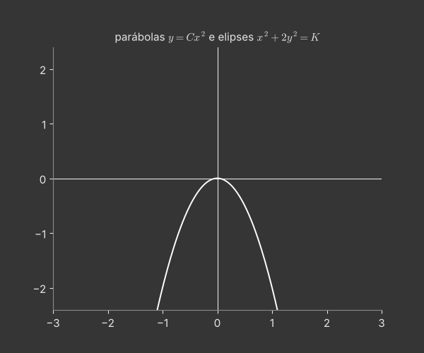

**Equação da família.** De $y=Cx^2$, $y'=2Cx$; eliminando $C=\frac y{x^2}$:
$$y'=\frac{2y}{x}.$$

**Ortogonais.** Em cada ponto, a inclinação da curva ortogonal é o oposto do inverso:
$$y'=-\frac{x}{2y}.$$

**Separando:** $2y\,dy=-x\,dx\Rightarrow y^2=-\frac{x^2}2+c$, ou seja,
$$x^2+2y^2=K,$$
uma família de **elipses** centradas na origem, com eixo maior horizontal (semieixos $\sqrt K$ e $\sqrt{K/2}$).

**Conferência num ponto:** em $(1,1)$, a parábola $y=x^2$ tem inclinação $2$ e a elipse $x^2+2y^2=3$ tem inclinação $-\frac12$; o produto é $-1$. ✓

**Onde aparece:** linhas de campo e equipotenciais, linhas de fluxo e curvas de nível são sempre famílias ortogonais.

**Animação.** As parábolas e as elipses são desenhadas alternadamente, formando uma malha de ângulos retos.

---

### 1.45 — Esvaziando um tanque

*Origem: OpenStax, inspirado na seção 1.3.*

> Pela lei de Torricelli, o nível de um tanque cilíndrico que esvazia por um furo no fundo satisfaz $h'=-0{,}1\sqrt h$ ($h$ em m, $t$ em min). Com $h(0)=4$, encontre $h(t)$, o tempo para esvaziar e o tempo para o nível cair à metade.

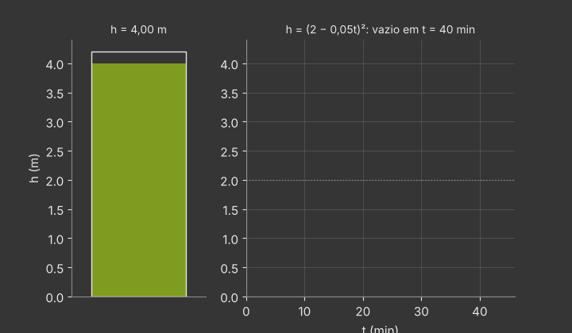

**Separando:** $\frac{dh}{\sqrt h}=-0{,}1\,dt\Rightarrow2\sqrt h=-0{,}1t+C$, e com $h(0)=4$, $C=4$:
$$\sqrt h=2-0{,}05t\ \Rightarrow\ h(t)=(2-0{,}05t)^2 .$$

**Esvaziamento:** $h=0$ em $t=40$ min (depois disso, $h\equiv0$).

**Metade do nível** ($h=2$): $\sqrt2=2-0{,}05t\Rightarrow t=\frac{2-\sqrt2}{0{,}05}\approx11{,}7$ min.

**Por que tão rápido?** A vazão é proporcional a $\sqrt h$: com o tanque cheio a água sai com mais pressão. A primeira metade da altura cai em $11{,}7$ min; a segunda leva os $28{,}3$ min restantes.

**Unicidade.** Em $h=0$ a função $\sqrt h$ não tem derivada limitada; por isso, voltando no tempo, não dá para saber *quando* um tanque vazio foi esvaziado (infinitas soluções terminam em $h=0$).

**Animação.** O nível do tanque desce ao lado do gráfico de $h(t)$, uma parábola que toca o eixo em $t=40$.

---
