# Capítulo 2 — Sequências e séries: exercícios

São 65 exercícios. Os pontos antes de cada número indicam a dificuldade: **•** fácil, **••** médio, **•••** difícil e **••••** desafio. Tente resolver antes de abrir a resposta. Os marcados com ★ têm [solução completa com animação](#soluções-completas).

Muitos enunciados são adaptados de *Calculus Volume 1* (OpenStax, CC BY-NC-SA 4.0).

## Lista

`•` **2.1** Calcule $\displaystyle\lim_{n\to\infty}\frac{2n^2+3n}{5n^2-1}$.

Resposta

$\tfrac25$.

`•` **2.2** Calcule $\displaystyle\lim_{n\to\infty}n\operatorname{sen}\frac1n$.

Resposta

$1$ (com $t=\frac1n$, $\frac{\operatorname{sen} t}t\to1$).

`•` **2.3** Calcule $\displaystyle\lim_{n\to\infty}\Big(1+\frac2n\Big)^{3n}$.

Resposta

$e^6$.

`•` **2.4** Calcule $\displaystyle\lim_{n\to\infty}\big(\sqrt{n^2+n}-n\big)$.

Resposta

$\tfrac12$ (multiplique pelo conjugado).

`•` **2.5** A sequência $a_n=(-1)^n\dfrac n{n+1}$ converge?

Resposta

Não: os termos pares tendem a $1$ e os ímpares a $-1$.

`•` **2.6** Calcule $\displaystyle\lim_{n\to\infty}\frac{n^2}{2^n}$.

Resposta

$0$ (L'Hôpital duas vezes em $\frac{x^2}{2^x}$).

`•` **2.7** Calcule $\displaystyle\sum_{n=0}^\infty\Big(-\frac23\Big)^n$.

Resposta

$\tfrac35$.

`•` **2.8** Calcule $\displaystyle\sum_{n=1}^\infty\frac{5\cdot3^n}{4^{n+1}}$.

Resposta

$\tfrac{15}4$.

`•` **2.9** Escreva $1{,}2\overline{3}=1{,}2333\ldots$ como fração usando uma série geométrica.

Resposta

$1{,}2+\tfrac{0{,}03}{1-0{,}1}=\tfrac{37}{30}$.

`•` **2.10** Calcule $\displaystyle\sum_{n=1}^\infty\frac1{(n+1)(n+2)}$ (telescópica).

Resposta

$\tfrac12$.

`•` **2.11** Mostre que $\displaystyle\sum_{n=1}^\infty\ln\frac n{n+1}$ diverge calculando as somas parciais.

Resposta

$S_k=-\ln(k+1)\to-\infty$.

`•` **2.12** Use o teste da divergência em $\sum\frac{n^2}{n^2+1}$ e em $\sum\cos\frac1n$.

Resposta

Ambas divergem (termos $\to1$).

`•` **2.13** Classifique: $\sum\frac1{n^{1{,}01}}$, $\sum\frac1{\sqrt n}$, $\sum n^{-\pi}$.

Resposta

Converge; diverge; converge.

`•` **2.14** Use o teste da integral para decidir sobre $\displaystyle\sum_{n=2}^\infty\frac1{n\ln n}$.

Resposta

$\int_2^\infty\tfrac{dx}{x\ln x}=\infty$: diverge.

`•` **2.15** Use o teste da integral em $\sum n\,e^{-n^2}$.

Resposta

$\int_1^\infty xe^{-x^2}dx=\tfrac1{2e}$: converge.

`•` **2.16** Use comparação direta: $\sum\frac1{n^3+n}$ e $\sum\frac{2+\operatorname{sen} n}{n}$.

Resposta

Converge ($<\tfrac1{n^3}$); diverge ($\ge\tfrac1n$).

`•` **2.17** Use comparação no limite em $\displaystyle\sum\frac{n+1}{n^3+2}$.

Resposta

Com $\tfrac1{n^2}$, $L=1$: converge.

`•` **2.18** Classifique $\displaystyle\sum\frac{(-1)^n}{\sqrt n}$ (absoluta, condicional ou divergente).

Resposta

Condicionalmente convergente.

`•` **2.19** Use o teste da razão em $\displaystyle\sum\frac n{3^n}$.

Resposta

$\rho=\tfrac13$: converge.

`•` **2.20** Use o teste da razão em $\displaystyle\sum\frac{3^n}{n^2}$.

Resposta

$\rho=3$: diverge.

`••` **2.21** **Raízes encaixadas.** Seja $a_1=\sqrt2$ e $a_{n+1}=\sqrt{2+a_n}$, isto é, $\sqrt2,\ \sqrt{2+\sqrt2},\ \sqrt{2+\sqrt{2+\sqrt2}},\dots$ Mostre que a sequência converge e calcule o limite. ★ [ver solução](#ex-2-21)

Resposta

Crescente e limitada por $2$; o limite é $2$.

`••` **2.22** **A bola que quica.** Uma bola cai de $10$ m e, a cada quique, sobe a $\frac34$ da altura anterior. Qual a distância total percorrida? E o tempo total, se a queda de uma altura $h$ leva $\sqrt{2h/g}$ ($g=9{,}8$)? ★ [ver solução](#ex-2-22)

Resposta

$70$ m; cerca de $19{,}9$ s.

`••` **2.23** **A lentidão da série harmônica.** Use o teste da integral para mostrar que $\ln(n+1)\le H_n\le1+\ln n$, em que $H_n=1+\frac12+\dots+\frac1n$. Quantos termos são necessários para $H_n$ passar de $10$? ★ [ver solução](#ex-2-23)

Resposta

$12\,367$ termos.

`••` **2.24** **Telescópica com salto.** Calcule $\displaystyle\sum_{n=1}^\infty\frac1{n(n+2)}$. ★ [ver solução](#ex-2-24)

Resposta

$\tfrac34$.

`••` **2.25** **Estimando $\sum 1/n^2$.** Calcule $S_{10}$ para $\sum\frac1{n^2}$ e use as cotas do resto pelo teste da integral para obter um intervalo para a soma. Compare com o valor exato $\frac{\pi^2}6$. ★ [ver solução](#ex-2-25)

Resposta

$S_{10}\approx1{,}5498$; $1{,}6407\le S\le1{,}6498$; $\frac{\pi^2}6\approx1{,}6449$.

`••` **2.26** **Uma alternada que converge depressa.** A série $\displaystyle\sum_{n=1}^\infty\frac{(-1)^{n+1}}{n!}$ vale $1-\frac1e$. Quantos termos garantem erro menor que $10^{-4}$? Compare a soma parcial com o valor exato. ★ [ver solução](#ex-2-26)

Resposta

$N=7$; $S_7\approx0{,}632143$ contra $0{,}632121$.

`••` **2.27** Calcule $\displaystyle\sum_{n=1}^\infty\frac{2^n+3^n}{6^n}$.

Resposta

$\tfrac12+1=\tfrac32$.

`••` **2.28** Para quais $x$ a série $\sum_{n=0}^\infty(x-1)^n$ converge? Qual a soma?

Resposta

$0<x<2$; soma $\tfrac1{2-x}$.

`••` **2.29** Calcule $\displaystyle\lim_{n\to\infty}\sqrt[n]n$.

Resposta

$1$ ($\ln\sqrt[n]n=\tfrac{\ln n}n\to0$).

`••` **2.30** Mostre que $\dfrac{n!}{n^n}\le\dfrac1n$ e conclua o limite.

Resposta

$\tfrac{n!}{n^n}=\tfrac1n\cdot\tfrac2n\cdots\tfrac nn\le\tfrac1n\to0$.

`••` **2.31** Calcule $\displaystyle\sum_{n=2}^\infty\frac1{n^2-1}$.

Resposta

$\tfrac12\big(\tfrac1{n-1}-\tfrac1{n+1}\big)$: soma $\tfrac34$.

`••` **2.32** Decida: $\displaystyle\sum\frac{\operatorname{arctg} n}{n^2}$.

Resposta

Converge ($\le\tfrac{\pi/2}{n^2}$).

`••` **2.33** Decida: $\displaystyle\sum_{n=2}^\infty\frac1{n(\ln n)^2}$.

Resposta

Converge ($\int_2^\infty=\tfrac1{\ln2}$).

`••` **2.34** Decida: $\displaystyle\sum\frac{n^2+1}{n^4-n+3}$.

Resposta

Converge (como $\tfrac1{n^2}$).

`••` **2.35** Decida: $\displaystyle\sum\operatorname{sen}\frac1n$.

Resposta

Diverge (comparação no limite com $\tfrac1n$).

`••` **2.36** Classifique $\displaystyle\sum\frac{(-1)^nn}{n^2+1}$.

Resposta

Condicionalmente convergente.

`••` **2.37** Decida: $\displaystyle\sum\frac{(-1)^nn!}{10^n}$.

Resposta

Diverge: os termos crescem sem limite.

`••` **2.38** Decida: $\displaystyle\sum\frac{n^n}{n!}$.

Resposta

$\rho=e>1$: diverge.

`••` **2.39** Decida com o teste da raiz: $\displaystyle\sum\Big(\frac n{n+1}\Big)^{n^2}$.

Resposta

$\sqrt[n]{a_n}=\big(\tfrac n{n+1}\big)^n\to\tfrac1e<1$: converge.

`••` **2.40** Decida: $\displaystyle\sum\frac1{3^n-n}$.

Resposta

Converge (comparação no limite com $\tfrac1{3^n}$).

`•••` **2.41** **O floco de neve de Koch.** Partindo de um triângulo equilátero de área $A_0$, a cada etapa cada lado é dividido em três e, sobre o terço do meio, constrói-se um novo triângulo equilátero para fora. Mostre que o perímetro tende a infinito, mas a área tende a $\frac85A_0$. ★ [ver solução](#ex-2-41)

Resposta

Perímetro $3\ell(4/3)^n\to\infty$; área $A_0\big(1+\sum_{n\ge1}\frac{3\cdot4^{n-1}}{9^n}\big)=\frac85A_0$.

`•••` **2.42** **Reordenar muda a soma.** Sabendo que $1-\frac12+\frac13-\frac14+\dots=\ln2$, mostre que a reordenação $1+\frac13-\frac12+\frac15+\frac17-\frac14+\cdots$ (dois positivos, um negativo) tem soma $\frac32\ln2$. ★ [ver solução](#ex-2-42)

Resposta

$\tfrac32\ln2\approx1{,}0397$.

`•••` **2.43** **Empilhando blocos.** Blocos de comprimento $1$ são empilhados na borda de uma mesa. Colocando o centro de massa dos $k$ blocos de cima sobre a borda do bloco $k+1$, o $k$-ésimo bloco (de cima para baixo) avança $\frac1{2k}$. Qual o balanço total com $n$ blocos? Quantos blocos são precisos para o bloco do topo ficar inteiramente fora da mesa? E para um balanço de $3$? ★ [ver solução](#ex-2-43)

Resposta

$\frac12H_n$; $4$ blocos; $227$ blocos.

`•••` **2.44** **O conjunto de Cantor.** Do intervalo $[0,1]$ retira-se o terço do meio $(\frac13,\frac23)$; de cada um dos dois intervalos restantes, retira-se o terço do meio; e assim por diante. Qual o comprimento total retirado? ★ [ver solução](#ex-2-44)

Resposta

$1$: o conjunto que sobra tem comprimento total zero.

`•••` **2.45** **Somando $\sum n/2^n$.** Mostre que $\displaystyle\sum_{n=1}^\infty\frac n{2^n}$ converge e calcule a soma usando $S-\frac12S$. Faça o mesmo para $\displaystyle\sum_{n=1}^\infty\frac{n^2}{2^n}$. ★ [ver solução](#ex-2-45)

Resposta

$2$ e $6$.

`•••` **2.46** Decida: $\displaystyle\sum_{n=3}^\infty\frac1{n\ln n\,\ln(\ln n)}$.

Resposta

Diverge (integral: $\ln\ln\ln x\to\infty$).

`•••` **2.47** Para quais $p$ a série $\displaystyle\sum_{n=2}^\infty\frac1{n(\ln n)^p}$ converge?

Resposta

$p>1$.

`•••` **2.48** Decida: $\displaystyle\sum\frac{\ln n}{n^{1{,}5}}$.

Resposta

Converge: $\ln n<n^{0{,}25}$ para $n$ grande, compare com $n^{-1{,}25}$.

`•••` **2.49** Decida: $\displaystyle\sum\frac1{n^{1+1/n}}$.

Resposta

Diverge: $\frac{1/n^{1+1/n}}{1/n}=n^{-1/n}\to1$.

`•••` **2.50** Decida: $\sum\big(\sqrt{n+1}-\sqrt n\big)$ e $\sum\dfrac{\sqrt{n+1}-\sqrt n}{n}$.

Resposta

A primeira diverge ($S_k=\sqrt{k+1}-1$); a segunda converge (termos $\sim\tfrac1{2n^{3/2}}$).

`•••` **2.51** Classifique $\displaystyle\sum_{n=2}^\infty\frac{(-1)^n}{\ln n}$.

Resposta

Condicionalmente convergente ($\tfrac1{\ln n}>\tfrac1n$).

`•••` **2.52** Classifique $\displaystyle\sum(-1)^n\Big(1-\cos\frac1n\Big)$.

Resposta

Absolutamente convergente ($1-\cos\tfrac1n\sim\tfrac1{2n^2}$).

`•••` **2.53** Decida: $\displaystyle\sum\frac{n^{100}}{1{,}01^n}$.

Resposta

$\rho=\tfrac1{1{,}01}<1$: converge (a exponencial vence).

`•••` **2.54** Decida: $\displaystyle\sum\frac{(n!)^2}{(2n)!}$.

Resposta

$\rho=\tfrac14$: converge.

`•••` **2.55** Decida: $\displaystyle\sum\frac{1\cdot3\cdot5\cdots(2n-1)}{2\cdot4\cdot6\cdots(2n)}$. Por que o teste da razão não basta?

Resposta

$\rho=1$; mas $a_n\ge\tfrac12\prod_{k=2}^n\tfrac{2k-2}{2k}=\tfrac1{2n}$: diverge por comparação com a harmônica.

`•••` **2.56** Seja $a_1=1$ e $a_{n+1}=\dfrac n{2n+1}a_n$. A série $\sum a_n$ converge?

Resposta

$\rho=\tfrac12$: converge.

`•••` **2.57** Calcule $\displaystyle\sum_{n=1}^\infty\frac1{n(n+1)(n+2)}$.

Resposta

$\tfrac12\big(\tfrac1{n(n+1)}-\tfrac1{(n+1)(n+2)}\big)$: soma $\tfrac14$.

`•••` **2.58** Mostre que $\sum\frac{(-1)^n}{n^p}$ converge para todo $p>0$ e que a convergência é absoluta se, e só se, $p>1$.

Resposta

Leibniz para $p>0$; $\sum\tfrac1{n^p}$ converge sse $p>1$.

`•••` **2.59** Quantos termos de $\sum\frac{(-1)^{n+1}}{n^3}$ garantem erro menor que $0{,}0005$? Calcule a aproximação.

Resposta

$\tfrac1{(N+1)^3}<0{,}0005$: $N=12$; $S_{12}\approx0{,}9013$ (valor $0{,}9015$).

`•••` **2.60** Seja $a_1=\tfrac12$ e $a_{n+1}=a_n(2-a_n)$. Mostre que a sequência é crescente e limitada por $1$ e calcule o limite.

Resposta

$1-a_{n+1}=(1-a_n)^2$; limite $1$.

`••••` **2.61** Mostre que $\displaystyle\sum_{n=1}^k\frac1{n^2}<2-\frac1k$ usando $\frac1{n^2}<\frac1{n(n-1)}$ e conclua que $\sum\frac1{n^2}\le2$.

Resposta

$S_k\le1+\sum_{n=2}^k\big(\tfrac1{n-1}-\tfrac1n\big)=2-\tfrac1k$.

`••••` **2.62** Seja $c_n=1+\frac12+\dots+\frac1n-\ln n$. Mostre que $\lbrace c_n\rbrace $ é decrescente e limitada inferiormente, logo converge (o limite é a constante de Euler $\gamma\approx0{,}5772$).

Resposta

$c_n-c_{n+1}=\ln\tfrac{n+1}n-\tfrac1{n+1}>0$; e $c_n\ge\ln(n+1)-\ln n>0$ pelo teste da integral.

`••••` **2.63** Usando $e=\sum_{n=0}^\infty\frac1{n!}$, prove que $e$ é irracional. (Suponha $e=\frac pq$ e multiplique por $q!$.)

Resposta

$q!\,e-q!\sum_{n\le q}\tfrac1{n!}$ seria inteiro positivo menor que $\tfrac1{q+1}+\tfrac1{(q+1)^2}+\dots=\tfrac1q\le1$.

`••••` **2.64** (Condensação de Cauchy) Se $a_n\ge0$ é decrescente, mostre que $\sum a_n$ converge se, e só se, $\sum2^ka_{2^k}$ converge. Use isso para refazer as séries $p$.

Resposta

Agrupe em blocos de $2^k$ termos; para $a_n=n^{-p}$, $\sum(2^{1-p})^k$ é geométrica.

`••••` **2.65** Se $a_n>0$ e $\sum a_n$ converge, prove que $\sum a_n^2$ converge. Mostre com um exemplo que $\sum\sqrt{a_n}$ pode divergir.

Resposta

$a_n<1$ a partir de algum $n$, logo $a_n^2<a_n$; exemplo $a_n=\tfrac1{n^2}$.

## Soluções completas

### 2.21 — Raízes encaixadas

*Origem: OpenStax, inspirado no Exemplo 2.2.*

> Seja $a_1=\sqrt2$ e $a_{n+1}=\sqrt{2+a_n}$, isto é, $\sqrt2,\ \sqrt{2+\sqrt2},\ \sqrt{2+\sqrt{2+\sqrt2}},\dots$ Mostre que a sequência converge e calcule o limite.

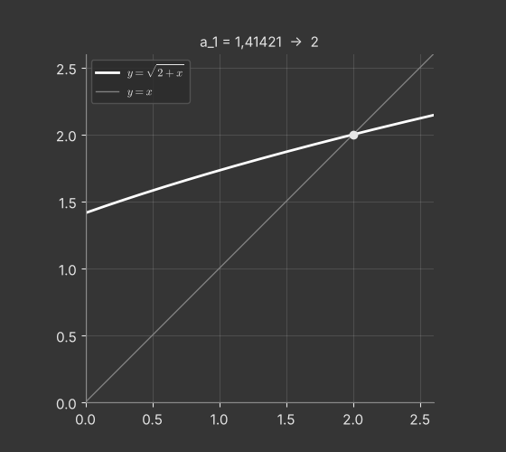

**Limitada por 2 (indução).** $a_1=\sqrt2<2$. Se $a_n<2$, então $a_{n+1}=\sqrt{2+a_n}<\sqrt4=2$.

**Crescente.** $a_{n+1}>a_n\iff2+a_n>a_n^2\iff(a_n-2)(a_n+1)<0$, verdadeiro para $0<a_n<2$.

**Converge** pelo Teorema da convergência monótona. Seja $L$ o limite. Passando ao limite em $a_{n+1}^2=2+a_n$:
$$L^2=2+L\ \Rightarrow\ L=2\ \ (\text{ou }L=-1,\ \text{impossível, pois }a_n>0).$$

**Valores:** $1{,}4142;\ 1{,}8478;\ 1{,}9616;\ 1{,}9904;\ 1{,}9976;\ 1{,}9994\dots$ A distância a $2$ cai cerca de 4 vezes a cada passo.

**Curiosidade:** $a_n=2\cos\frac{\pi}{2^{n+1}}$ (fórmula do arco metade), o que confirma o limite e a velocidade.

**Animação.** O "diagrama de teia": a partir de $a_1$, sobe-se até a curva $y=\sqrt{2+x}$ e volta-se à reta $y=x$, convergindo para o ponto fixo $(2,2)$.

---

### 2.22 — A bola que quica

*Origem: OpenStax, inspirado no Teorema 2.2.*

> Uma bola cai de $10$ m e, a cada quique, sobe a $\frac34$ da altura anterior. Qual a distância total percorrida? E o tempo total, se a queda de uma altura $h$ leva $\sqrt{2h/g}$ ($g=9{,}8$)?

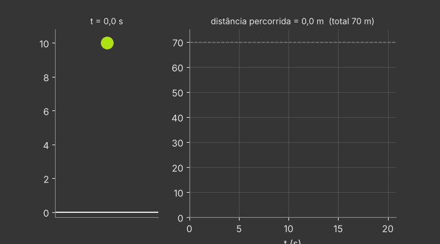

**Distância.** A bola desce $10$, depois sobe e desce $10\cdot\frac34$, depois $10\cdot\big(\frac34\big)^2$, e assim por diante:
$$D=10+2\sum_{n=1}^\infty10\Big(\frac34\Big)^n=10+2\cdot\frac{7{,}5}{1-3/4}=10+60=70\ \text{m}.$$

**Tempo.** Subir ou descer de uma altura $h$ leva $\sqrt{2h/g}$, e a altura do $n$-ésimo quique é $10(3/4)^n$, logo cada tempo é o anterior vezes $r=\sqrt{3/4}\approx0{,}866$. Com $t_0=\sqrt{20/9{,}8}\approx1{,}429$ s:
$$T=t_0+2\sum_{n=1}^\infty t_0r^n=t_0\Big(1+\frac{2r}{1-r}\Big)\approx1{,}429\cdot13{,}93\approx19{,}9\ \text{s}.$$

**Infinitos quiques em tempo finito.** Como os tempos formam uma série geométrica convergente, a bola quica infinitas vezes e para em menos de 20 segundos (no modelo; na prática, efeitos que o modelo ignora param a bola antes).

**Animação.** A bola quica enquanto as somas parciais da distância se aproximam de $70$ m.

---

### 2.23 — A lentidão da série harmônica

*Origem: OpenStax, inspirado na seção 2.2.*

> Use o teste da integral para mostrar que $\ln(n+1)\le H_n\le1+\ln n$, em que $H_n=1+\frac12+\dots+\frac1n$. Quantos termos são necessários para $H_n$ passar de $10$?

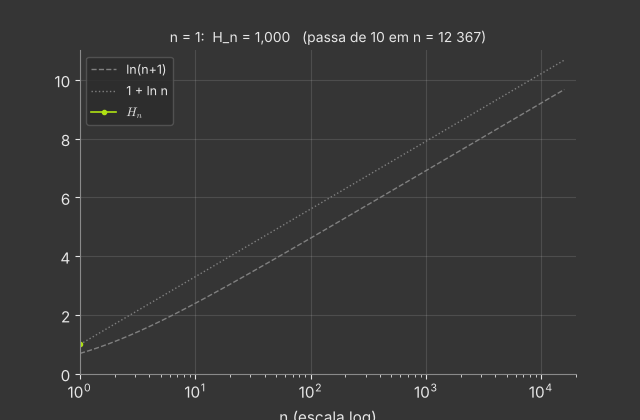

**Retângulos acima da curva:** cada $\frac1k$ é a área de um retângulo de base $[k,k+1]$ que fica acima de $y=\frac1x$:
$$H_n\ \ge\ \int_1^{n+1}\frac{dx}x=\ln(n+1).$$

**Retângulos abaixo da curva:** deslocando para $[k-1,k]$, os retângulos de $\frac12,\dots,\frac1n$ ficam abaixo:
$$H_n-1\ \le\ \int_1^n\frac{dx}x=\ln n.$$

**Divergência confirmada:** $H_n\ge\ln(n+1)\to\infty$.

**Passar de 10:** precisamos de $\ln(n+1)\approx10$, isto é, $n$ da ordem de $e^{10}-1\approx22\,025$ pela cota inferior. A estimativa mais fina $H_n\approx\ln n+\gamma$ (com $\gamma\approx0{,}5772$, a constante de Euler) dá $n\approx e^{10-0{,}5772}\approx12\,367$, e de fato $H_{12\,367}$ é o primeiro acima de $10$.

**Escala:** para passar de $100$ seriam precisos cerca de $1{,}5\times10^{43}$ termos.

**Animação.** As somas parciais (em escala logarítmica de $n$) seguem a reta $\ln n+\gamma$, presas entre as duas cotas.

---

### 2.24 — Telescópica com salto

*Origem: OpenStax, inspirado no Exemplo 2.3.*

> Calcule $\displaystyle\sum_{n=1}^\infty\frac1{n(n+2)}$.

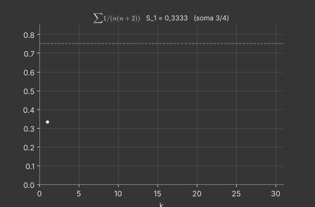

**Frações parciais:** $\dfrac1{n(n+2)}=\dfrac12\Big(\dfrac1n-\dfrac1{n+2}\Big)$.

**Soma parcial.** Agora os termos se cancelam *dois a dois de distância*:
$$S_k=\frac12\Big[\Big(1-\tfrac13\Big)+\Big(\tfrac12-\tfrac14\Big)+\Big(\tfrac13-\tfrac15\Big)+\dots+\Big(\tfrac1k-\tfrac1{k+2}\Big)\Big].$$
Sobram os dois primeiros positivos e os dois últimos negativos:
$$S_k=\frac12\Big(1+\frac12-\frac1{k+1}-\frac1{k+2}\Big)\ \xrightarrow{k\to\infty}\ \frac12\cdot\frac32=\frac34 .$$

**Cuidado** com o erro comum de achar que só sobra o primeiro termo: quando o "salto" é 2, sobram dois termos de cada ponta.

**Conferência numérica:** $S_{10}\approx0{,}6629$, $S_{100}\approx0{,}7401$, $S_{1000}\approx0{,}7490$.

**Animação.** Os termos são cancelados aos pares, e o gráfico de $S_k$ se aproxima de $3/4$.

---

### 2.25 — Estimando $\sum 1/n^2$

*Origem: OpenStax, inspirado no Exemplo 2.4.*

> Calcule $S_{10}$ para $\sum\frac1{n^2}$ e use as cotas do resto pelo teste da integral para obter um intervalo para a soma. Compare com o valor exato $\frac{\pi^2}6$.

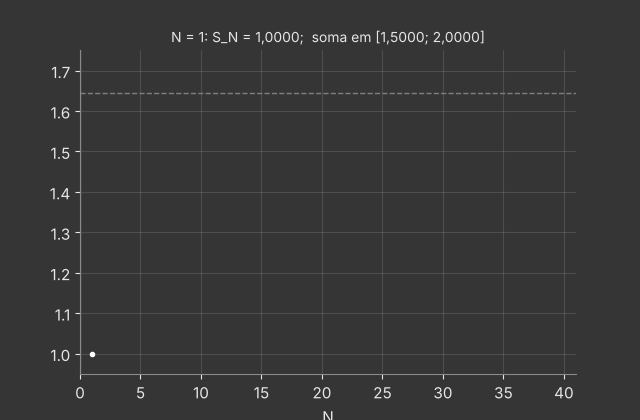

**Soma parcial:** $S_{10}=1+\frac14+\frac19+\dots+\frac1{100}\approx1{,}549768$.

**Cotas do resto** com $f(x)=\frac1{x^2}$:
$$\int_{11}^\infty\frac{dx}{x^2}=\frac1{11}\ \le\ R_{10}\ \le\ \int_{10}^\infty\frac{dx}{x^2}=\frac1{10}.$$

**Intervalo para a soma:**
$$1{,}640677\ \le\ S\ \le\ 1{,}649768 .$$

**Melhor estimativa:** o ponto médio, $1{,}645222$, erra o valor exato $\frac{\pi^2}6=1{,}644934$ por apenas $0{,}0003$, muito melhor que $S_{10}$ sozinha (erro $0{,}095$). Para chegar a esse erro só com somas parciais seriam precisos uns $3000$ termos.

**O valor $\pi^2/6$** (problema de Basileia, resolvido por Euler em 1734) aparece de novo no próximo capítulo.

**Animação.** As somas parciais sobem devagar; a faixa $[S_N+\frac1{N+1},\,S_N+\frac1N]$ estreita-se em torno de $\pi^2/6$.

---

### 2.26 — Uma alternada que converge depressa

*Origem: OpenStax, inspirado no Teorema 2.8.*

> A série $\displaystyle\sum_{n=1}^\infty\frac{(-1)^{n+1}}{n!}$ vale $1-\frac1e$. Quantos termos garantem erro menor que $10^{-4}$? Compare a soma parcial com o valor exato.

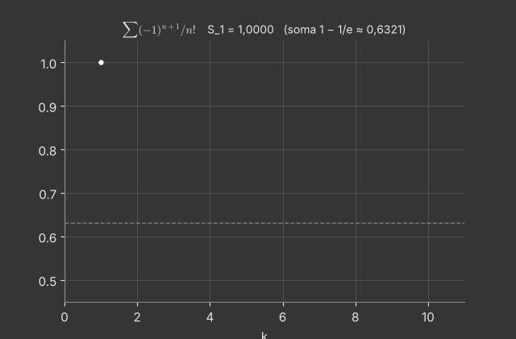

**Hipóteses de Leibniz:** $b_n=\frac1{n!}$ decresce e tende a $0$. ✓

**Cota do erro:** $|R_N|\le b_{N+1}=\frac1{(N+1)!}$. Queremos $(N+1)!>10\,000$: $7!=5040$ não basta, $8!=40\,320$ basta. Logo $N=7$.

**Soma parcial:**
$$S_7=1-\frac12+\frac16-\frac1{24}+\frac1{120}-\frac1{720}+\frac1{5040}\approx0{,}632143 .$$

**Valor exato:** $1-e^{-1}\approx0{,}632121$; o erro real é $2{,}2\times10^{-5}$, abaixo da cota $\frac1{40\,320}\approx2{,}5\times10^{-5}$.

**Sinal do erro:** como paramos num termo positivo, $S_7$ fica *acima* da soma. Em séries alternadas, a soma está sempre entre duas somas parciais consecutivas: $S_6<S<S_7$.

**Contraste** com $\sum\frac{(-1)^{n+1}}n$, que precisa de $10\,000$ termos para o mesmo erro: os fatoriais tendem a zero muito mais depressa.

**Animação.** As somas parciais pulam de um lado para o outro de $1-1/e$, com saltos que encolhem rapidamente.

---

### 2.41 — O floco de neve de Koch

*Origem: OpenStax, inspirado na seção 2.2.*

> Partindo de um triângulo equilátero de área $A_0$, a cada etapa cada lado é dividido em três e, sobre o terço do meio, constrói-se um novo triângulo equilátero para fora. Mostre que o perímetro tende a infinito, mas a área tende a $\frac85A_0$.

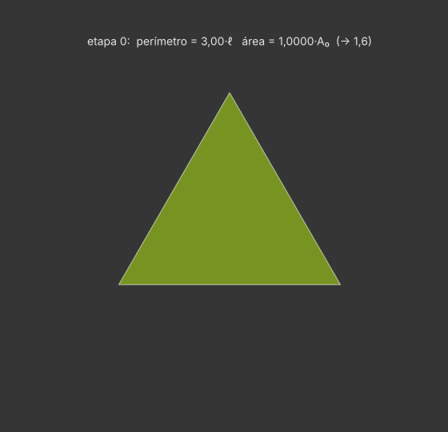

**Perímetro.** Cada lado vira 4 segmentos de $\frac13$ do comprimento: o perímetro é multiplicado por $\frac43$ a cada etapa, $P_n=3\ell\big(\frac43\big)^n\to\infty$.

**Área.** Na etapa $n\ge1$:
- número de triângulos novos: um por lado da etapa anterior, $3\cdot4^{n-1}$;
- área de cada um: lado $\frac1{3^n}$ do original, área $\frac{A_0}{9^n}$.

$$A=A_0+\sum_{n=1}^\infty3\cdot4^{n-1}\cdot\frac{A_0}{9^n}=A_0\Big(1+\frac13\sum_{n=1}^\infty\Big(\frac49\Big)^{n-1}\Big)=A_0\Big(1+\frac13\cdot\frac{1}{1-4/9}\Big)=\frac85A_0 .$$

**O paradoxo.** Uma região de área finita cercada por uma curva de comprimento infinito. Não há contradição: a curva fica cada vez mais enrugada dentro de uma região limitada (cabe num círculo).

**Dimensão.** A curva de Koch tem dimensão fractal $\frac{\ln4}{\ln3}\approx1{,}26$: "mais que uma curva, menos que uma superfície".

**Animação.** As cinco primeiras etapas do floco, com o perímetro e a área de cada uma.

---

### 2.42 — Reordenar muda a soma

*Origem: OpenStax, inspirado na seção 2.5.*

> Sabendo que $1-\frac12+\frac13-\frac14+\dots=\ln2$, mostre que a reordenação $1+\frac13-\frac12+\frac15+\frac17-\frac14+\cdots$ (dois positivos, um negativo) tem soma $\frac32\ln2$.

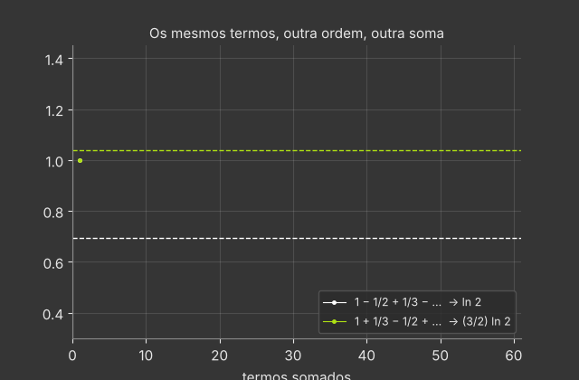

**Duas séries conhecidas.**
$$\ln2=1-\tfrac12+\tfrac13-\tfrac14+\tfrac15-\tfrac16+\tfrac17-\tfrac18+\cdots$$
$$\tfrac12\ln2=\phantom{1}\ \ \ \tfrac12\phantom{+\tfrac13}-\tfrac14\phantom{+\tfrac15}+\tfrac16\phantom{+\tfrac17}-\tfrac18+\cdots$$
(a segunda é a primeira multiplicada por $\frac12$, com zeros intercalados, o que não muda a soma).

**Somando termo a termo** (permitido para séries convergentes):
$$\tfrac32\ln2=1+\tfrac13-\tfrac12+\tfrac15+\tfrac17-\tfrac14+\cdots$$
Os $\frac12$ se cancelam, os $-\frac14$ dobram, os $\frac16$ se cancelam… e sobra exatamente a reordenação pedida.

**Os mesmos termos, outra soma.** Isso só é possível porque a convergência é **condicional**: a parte positiva $1+\frac13+\frac15+\cdots$ e a negativa $\frac12+\frac14+\cdots$ divergem separadamente. Riemann mostrou que, reordenando, se obtém *qualquer* número real (ou $\pm\infty$). Com convergência absoluta isso não acontece.

**Conferência:** com 300 000 termos, a soma parcial vale $1{,}039718$, e $\frac32\ln2=1{,}039721$.

**Animação.** As somas parciais das duas ordenações são traçadas lado a lado: uma vai para $\ln2$, a outra para $\frac32\ln2$.

---

### 2.43 — Empilhando blocos

*Origem: OpenStax, inspirado na seção 2.2.*

> Blocos de comprimento $1$ são empilhados na borda de uma mesa. Colocando o centro de massa dos $k$ blocos de cima sobre a borda do bloco $k+1$, o $k$-ésimo bloco (de cima para baixo) avança $\frac1{2k}$. Qual o balanço total com $n$ blocos? Quantos blocos são precisos para o bloco do topo ficar inteiramente fora da mesa? E para um balanço de $3$?

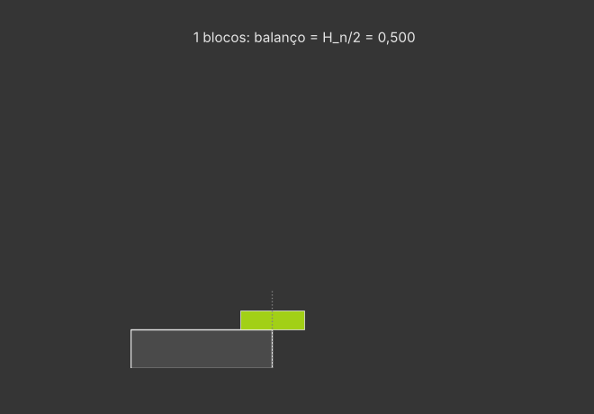

**Balanço total:** somando os avanços,
$$d_n=\frac12+\frac14+\frac16+\dots+\frac1{2n}=\frac12H_n .$$

**Por que $\frac1{2k}$?** Os $k$ blocos de cima têm centro de massa exatamente sobre a borda do bloco $k+1$. Acrescentando o bloco $k+1$ (centro a $\frac12$ de sua borda), o centro de massa dos $k+1$ blocos se desloca $\frac{1/2}{k+1}$ em relação a essa borda: é o avanço do próximo nível.

**Topo inteiramente fora** ($d_n>1$, ou seja, $H_n>2$): $H_3=1{,}83$, $H_4=2{,}08$. Bastam **4 blocos**.

**Balanço de 3** ($H_n>6$): $n=227$ blocos.

**Sem limite.** Como $H_n\to\infty$, o balanço pode ser tão grande quanto se queira, mas cresce como $\frac12\ln n$: para um balanço de $10$ comprimentos seriam precisos cerca de $2{,}7\times10^8$ blocos.

**Animação.** A pilha cresce de cima para baixo e o balanço total acompanha $\frac12H_n$.

---

### 2.44 — O conjunto de Cantor

*Origem: OpenStax, inspirado na seção 2.2.*

> Do intervalo $[0,1]$ retira-se o terço do meio $(\frac13,\frac23)$; de cada um dos dois intervalos restantes, retira-se o terço do meio; e assim por diante. Qual o comprimento total retirado?

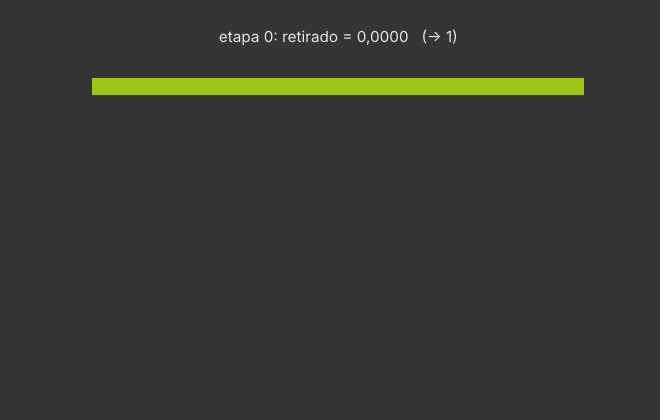

**Etapa $n$:** retiram-se $2^{n-1}$ intervalos de comprimento $\frac1{3^n}$.

**Comprimento retirado:**
$$\sum_{n=1}^\infty\frac{2^{n-1}}{3^n}=\frac13\sum_{n=1}^\infty\Big(\frac23\Big)^{n-1}=\frac13\cdot\frac1{1-2/3}=1 .$$

**O que sobra.** O conjunto de Cantor tem "comprimento" zero, mas não é vazio nem pequeno: contém $0$, $1$, $\frac13$, $\frac23$, $\frac14$ (!) e, na verdade, tantos pontos quanto o próprio $[0,1]$. São os números cuja expansão na base 3 pode ser escrita só com os dígitos $0$ e $2$; por exemplo, $\frac14=0{,}\overline{02}_3$.

**Após $n$ etapas** sobra $\big(\frac23\big)^n$ do comprimento: depois de 10 etapas, apenas $1{,}7\%$.

**Animação.** As etapas da construção, com o comprimento retirado acumulado se aproximando de $1$.

---

### 2.45 — Somando $\sum n/2^n$

*Origem: OpenStax, inspirado no Teorema 2.2.*

> Mostre que $\displaystyle\sum_{n=1}^\infty\frac n{2^n}$ converge e calcule a soma usando $S-\frac12S$. Faça o mesmo para $\displaystyle\sum_{n=1}^\infty\frac{n^2}{2^n}$.

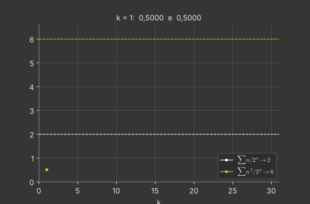

**Convergência (razão):** $\frac{a_{n+1}}{a_n}=\frac{n+1}{2n}\to\frac12<1$.

**Primeira soma.** Seja $S=\frac12+\frac24+\frac38+\frac4{16}+\cdots$. Então
$$S-\frac12S=\frac12+\frac14+\frac18+\cdots=1\ \Rightarrow\ S=2 .$$
(Deslocando $\frac12S$ uma posição, cada termo $\frac n{2^n}-\frac{n-1}{2^n}=\frac1{2^n}$.)

**Segunda soma.** Seja $T=\sum\frac{n^2}{2^n}$. Do mesmo modo,
$$T-\frac12T=\sum_{n=1}^\infty\frac{n^2-(n-1)^2}{2^n}=\sum\frac{2n-1}{2^n}=2S-1=3\ \Rightarrow\ T=6 .$$

**Conferência:** $S_{20}\approx1{,}99998$; $T_{30}\approx5{,}99999$.

**Ideia geral.** No próximo capítulo, derivando a série geométrica $\sum x^n=\frac1{1-x}$, obtemos $\sum nx^n=\frac x{(1-x)^2}$, que em $x=\frac12$ dá $2$.

**Animação.** As somas parciais de $\sum n/2^n$ e $\sum n^2/2^n$ se aproximam de $2$ e $6$.

---
